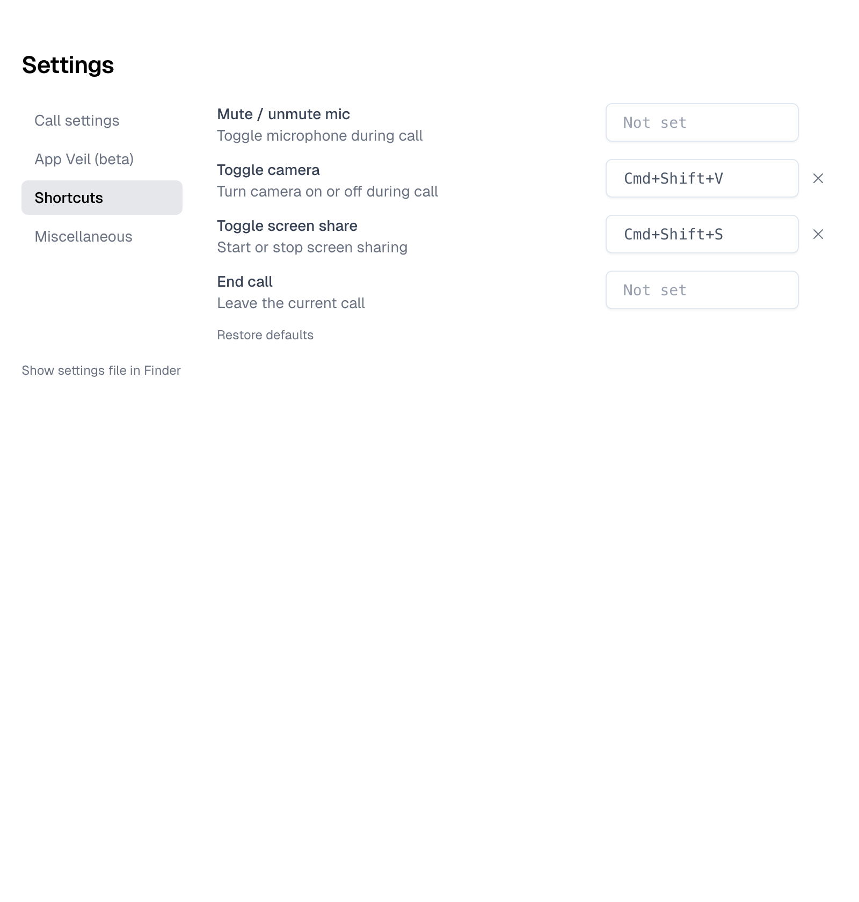

# 0010: Clearable call shortcuts

## Goal

The four call shortcuts in Settings › Shortcuts (Mute / unmute mic, Toggle camera, Toggle screen
share, End call) always held a combination, so in a call they took those keys from every other app
(⌘⇧A, ⌘⇧V, ⌘⇧S, ⌘⇧W are common in editors and browsers). With this change each one can be cleared to
"Not set", so nothing fires for it and its keys work in other apps again. Recording a new shortcut
still works, and saved settings files keep loading.

## Behavior

Approved by the user 2026-11-10 (alignment al_1, "Clearable call shortcuts in Settings ›
Shortcuts").

- **B1.** While a shortcut is set, the Settings window shall show a small × clear button next to its
  field, outside the field's box, to its right, always visible. Clicking it shall make the shortcut
  Not set: nothing fires for it in calls and its keys reach other apps. The × is the only way to
  clear a shortcut. A cleared shortcut stays Not set across restarts.
- **B2.** While recording, Backspace and Delete shall not clear the shortcut (any key without ⌘,
  Ctrl or ⌥ is ignored, as before). Esc shall still cancel recording. The recording text stays
  "Recording...".
- **B3.** A shortcut that is Not set shall show "Not set" in grey, and no × (a placeholder keeps the
  four fields aligned).
- **B4.** When the user records keys another action already uses, that other action shall become
  Not set. (Before, it went back to its default, which could be the same keys: both rows then showed
  the same combination and only one worked in a call.)
- **B5.** Only one field shall record at a time: starting one stops any other. Leaving the
  Shortcuts section shall stop recording (before, the keydown listener survived the section's
  unmount and kept eating keys). Clicking an × or Restore defaults also stops recording.
- **B6.** A "Restore defaults" link under the four rows shall put all four back to their defaults
  (⌘⇧A mic, ⌘⇧V camera, ⌘⇧S screen share, ⌘⇧W end call) in one click, with no confirmation.
- **B7.** During a call, clearing, recording or restoring shall take effect at once: set shortcuts
  work, cleared ones stop. The call window's mic, camera, screen share and End call hover hints
  shall show a shortcut only while it is set, and shall update as soon as it is cleared, recorded or
  restored, without the call window needing focus.
- **B8.** Settings files saved by earlier versions shall keep loading with their shortcuts unchanged
  (a missing shortcut uses its default), and an empty or cleared value shall never make startup or
  the Settings window fail.

Older clients: shortcuts are local; nothing goes over the network. A settings file with a cleared
shortcut (`"none"`) opened by an older Hopp build keeps loading there (the field is still a string),
but that build tries to register `"none"` as an accelerator, fails and logs it, so the shortcut
stays unregistered there too.

Out of scope, known limitation: recording reads the typed character (`KeyboardEvent.key`), not the
physical key, so ⌥-combinations or ⇧ with a digit probably record the symbol the keys type ("å",
"@") instead of the key, and then never fire in a call.

## Design

- **Storage** (`tauri/src-tauri/src/app_state.rs`). `UserSettings.shortcut_*` stay
  `Option<String>`: `None` still means "use the default" (`resolve_shortcuts` fills only `None`), and
  a cleared shortcut is stored as `Some("none")` (`SHORTCUT_NONE`). `is_shortcut_set` is false for
  `""` and any spelling of `"none"`, whitespace ignored; `normalize_shortcut` turns those into
  `"none"`; `UserSettings::reset_shortcuts` sets all four to `None`. Rejected: a new type or an enum
  for the field, because any serde failure on `AppStateInternal` makes `AppState::new` fall back to
  defaults and drop every setting and the JWT.
- **Commands** (`tauri/src-tauri/src/main.rs`). `set_shortcut_*` now store `normalize_shortcut(accel)`
  (before, `""` became `None`, i.e. the default). New `reset_shortcuts` command (Restore defaults).
  Both go through `update_shortcuts`: save, `call_state::refresh_call_shortcuts` (re-registers on
  the main thread if a call is active, unchanged), then emit the app event `user_settings_changed`.
- **Registration** (`tauri/src-tauri/src/shortcuts.rs`). `register_call_shortcuts` registers each
  shortcut through one helper that skips (and logs) one that isn't set; before, only End call was
  guarded (by `is_empty()`). Unregistering is still `unregister_all` on call end or refresh.
- **Settings window** (`tauri/src/windows/settings/main.tsx`). The four rows come from
  `SHORTCUT_ROWS`. `SettingsWindow` owns which row records (`recordingShortcut`) and clears it on
  every section change; `ShortcutRow` installs its capture-phase keydown listener in an effect keyed
  on `recording`, so it goes away when recording stops or the row unmounts. The × is a sibling
  `<button>` after the field (never inside it), `HiXMark`, styled like the App Veil remove button
  but always visible. `commitShortcut` skips the conflict loop for a cleared value and sends
  `SHORTCUT_NONE` to a conflicting row. Restore defaults is styled like the "Show settings file in
  Finder" link.
- **Call window** (`tauri/src/components/ui/call-center.tsx`). Hints go through `shortcutHint`
  (`isShortcutSet`, `tauri/src/core_payloads.ts`). `CallCenter` listens for `user_settings_changed`
  and invalidates the `["user-settings"]` query, which otherwise refetched only on window focus.
  The main window already has `core:default`, so listening needs no capability change.
- Upstream files changed: all of the above (rebase risk is small and local to the shortcut code).

## Tasks

- [x] Storage helpers, reset, normalize on save, guarded registration, settings-changed event
- [x] Settings UI: ×, Not set, one recorder at a time, listener cleanup, conflicts, Restore defaults
- [x] Call window hints and live refresh
- [x] Rust tests (`app_state::shortcut_tests`)
- [x] `DATAICO.md` divergence row
- [x] Discoveries preserved in [notes](0010-clearable-shortcuts/notes.md)
- [ ] The user's manual check below, then merge

## Verification

Automated (`cargo test` in `tauri/src-tauri`, `app_state::shortcut_tests`):

- B8: a settings JSON with mic `"none"`, camera missing, screen share `null` and end call `"Cmd+K"`
  deserializes; `resolve_shortcuts` keeps `"none"` and `"Cmd+K"` and fills the two defaults.
- B1: `is_shortcut_set` is false for `""`, whitespace, `"none"`, `"NONE"`, `"None"`, `" none "`;
  `normalize_shortcut` stores those as `"none"` and keeps `"Cmd+K"`; a cleared mic shortcut written
  through `AppState` survives a reload, with the JWT and the other shortcuts intact.
- B6: after `reset_shortcuts` all four resolve to their defaults, also after a reload.

The UI behaviors (B1–B7) have no automated test (`tauri/` has no frontend test runner).

### Manual check

Run by the user on a build of this branch:

1. Settings › Shortcuts: click the × next to Mute / unmute mic. The field shows "Not set" in grey
   and its × disappears.
2. Quit and restart Hopp. Settings › Shortcuts still shows the mic shortcut as "Not set".
3. Start a call. Press ⌘⇧A: the mic does not toggle, and ⌘⇧A works in another app again (e.g. in a
   browser or editor that uses it).
4. Hover the mic button in the call window: its hint shows no shortcut.
5. Still in the call, click the mic field in Settings, press a new combination (e.g. ⌘⇧M) and check
   it toggles the mic in the call.
6. Still in the call, click the × next to Toggle camera in Settings. Without clicking the call
   window, hover its camera button: the shortcut hint is already gone.
7. Click "Restore defaults" mid-call: all four show their defaults, and ⌘⇧A mutes again.
8. Under AeroSpace (§TILING-WM): nothing here changes windows, but confirm clicking × and Restore
   defaults doesn't switch workspaces or move the Settings window.

## Decisions

- **Q:** Where does the clear button go? **A:** A small × always visible when the shortcut is set,
  outside the field's box, to its right ("the x should be outside the box! - much more clear").
  (2026-11-10)
- **Q:** Clear with Backspace/Delete while recording? **A:** No; the × is the only way. Esc still
  cancels; the recording text stays as it is. (2026-11-10)
- **Q:** How does a cleared field look? **A:** "Not set" in grey. (2026-11-10)
- **Q:** Recording keys another action uses? **A:** That other action becomes Not set. (2026-11-10)
- **Q:** Several fields recording, or recording after leaving the section? **A:** One field at a
  time; leaving the Shortcuts section stops recording. (2026-11-10)
- **Q:** A way back to the defaults? **A:** A "Restore defaults" link under the four rows, one click,
  no confirmation; mid-call the default keys work at once. (2026-11-10)
- **Q:** Call window hints mid-call? **A:** They update as soon as a shortcut changes, without the
  call window needing focus (from the plan review). (2026-11-10)

## Screenshots

Rendered from this branch's UI build in a headless browser with mocked settings, not from the
running app.

All four set to the defaults:

Mute / unmute mic and End call cleared:

Toggle camera recording:

## Completion notes

[Notes, quirks, awkward behavior, gotchas and bugs](0010-clearable-shortcuts/notes.md)
